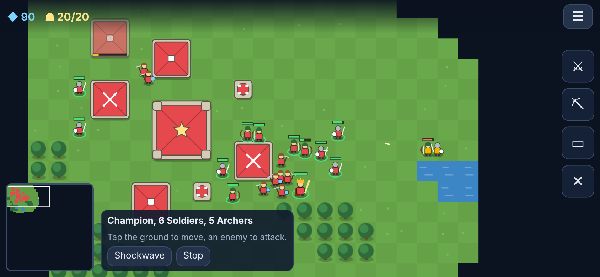

# Warcamp

A real-time strategy game for 1 to 4 players that runs in the browser and installs as an app (PWA).
Gather crystal, build a base, raise an army and destroy every enemy building.



- **Single player** against 1 to 3 computers (easy, normal or hard).
- **Multiplayer** for 2 to 4 people on their own devices, with computers in the empty seats if wanted:
  free for all, or everyone against the computers.
- **Touch first**, and it also plays with mouse and keyboard.
- **Offline**: after the first visit the game is cached and single player works with no connection.

The roadmap towards a full campaign game with three worlds and six factions is in [PLAN.md](PLAN.md).

## Play it

Locally, from the repository root:

```sh
python3 -m http.server 8000 --directory Warcamp
# open http://localhost:8000
```

On a phone it has to be served over HTTPS. `.github/workflows/warcamp-pages.yml` publishes this folder with
GitHub Pages whenever `Warcamp/` changes on `main`. To switch it on: repository Settings › Pages › Source:
**GitHub Actions**. The game is then at `https://<user>.github.io/<repo>/`, and "Add to Home Screen" (iPhone:
Share menu; Android: the Install button in the menu) makes it an app.

## Multiplayer

One player taps **Host a multiplayer game** and gets a 4-letter code. The others type the code and tap **Join**.
The host's device runs the game and the other devices connect straight to it (WebRTC, through
[PeerJS](https://peerjs.com)), so there is no game server to run.

- Everyone needs an internet connection to find each other, even in the same room.
- The room is found through the free public PeerJS service. It is fine for games with friends and comes with no
  guarantee; on some mobile networks a direct connection cannot be made. Running our own relay is in the roadmap.
- The host should keep the game on screen: phones pause web pages in the background.
- If a player leaves, a computer takes over their base. If the host leaves, the game ends.

## Controls

| | Touch | Mouse and keyboard |
| --- | --- | --- |
| Select | Tap. Double-tap a unit for all of its kind on screen | Click, Shift-click to add |
| Select many | Hold, then drag a box (or tap ▭ first) | Drag a box |
| Order (move, attack, gather, help build) | Tap the target | Right-click the target |
| Scroll | Drag | Arrow keys, WASD, middle-drag |
| Zoom | Pinch | Wheel |
| Whole army / idle worker | ⚔ / ⛏ | Q / . |
| Cancel | ✕ | Esc |

## How it is built

No build step and no dependencies to install: plain ES modules and a canvas.

| File | What it does |
| --- | --- |
| `js/data.js` | Every unit and building number. Balance changes happen here. |
| `js/sim.js` | The simulation: map generation, pathfinding, gathering, building, combat, win check. No DOM, no network. |
| `js/ai.js` | The computer player. It gives the same commands a person does. |
| `js/render.js` | What a screen knows (rebuilt from snapshots), fog of war, drawing, minimap. |
| `js/net.js` | Room codes and connections. |
| `js/main.js` | Menus, lobby, controls, game loop. |
| `sw.js`, `manifest.webmanifest` | Offline cache and install. Bump `VERSION` in `sw.js` when files are added or removed. |

The host steps the simulation ten times a second and sends every screen a snapshot. Other players send only
their orders. The host draws from the same snapshots, so single player and multiplayer run the same code.

## Tests

```sh
node Warcamp/test/sim.test.mjs
```

Plays complete computer-versus-computer games without a browser and checks that maps are fair and connected,
that every game ends, that workers never stand idle and that bad input from the network is ignored.
Adding `?net=local` to the URL connects tabs of one browser to each other without the internet, and
`?speed=8` fast-forwards a hosted game; both are for testing.

`vendor/peerjs.min.js` is PeerJS 1.5.4 (MIT licence).
